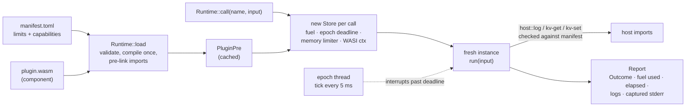

# wasm-plugin-runtime

[](https://github.com/HOFFMAN-ALTERNATIVE/wasm-plugin-runtime/actions/workflows/ci.yml)


Run untrusted plugins inside your process without trusting them. Each call gets a fresh WebAssembly instance with four hard limits: instruction fuel, linear memory, wall-clock time, and capabilities granted in a TOML manifest. A plugin that loops forever, allocates until it dies, panics, floods logs or tries to read `/etc/passwd` gets a typed `Outcome` back. The host keeps serving the next call.

Built on wasmtime 49 and the WebAssembly component model. The plugin contract is one WIT file, so any language with a component toolchain can target it. The five in `plugins/` are Rust.

## Measured

Release build, 8 vCPU Xeon cloud VM shared with other workloads, fresh instance per call (instantiate + `run` + teardown):

| plugin | calls | threads | calls/s | p50 µs | p99 µs |
|---|---:|---:|---:|---:|---:|
| hello | 5 000 | 1 | 27 727 | 21 | 38 |
| hello | 20 000 | 4 | 30 172 | 76 | 571 |
| wordfreq, 100 KB input | 200 | 1 | 464 | 2 066 | 2 645 |

- Loading a plugin (compile with Cranelift, link, pre-instantiate) takes about 55-60 ms. It happens once per plugin, not per call.
- `hostile spin` burns its 200M fuel budget and is stopped in about 13 ms.
- Four threads barely beat one. Every call maps and unmaps fresh linear memory, and that kernel work serializes. Wasmtime's pooling allocator is the fix; see Limits.

CI re-runs the `hello` benchmark on every push and writes it to the job summary, so the numbers above can be checked against a clean runner.

## How it works



- **Fuel** caps instructions per call. Deterministic, so a test can assert that a loop used exactly its budget.
- **Epoch deadline** caps wall-clock time. Fuel alone does not catch a plugin blocked in a host call, and wall-clock alone is not reproducible, so both are on. Precision is one 5 ms tick.
- **Memory limiter** refuses `memory.grow` past `memory-mib` and records that it did, so the resulting trap is reported as `MemoryLimit` rather than a generic trap.
- **Capabilities** default to nothing: no network, no environment variables, no arguments, no inherited stdio, no filesystem. A manifest can grant per-plugin KV storage and read-only directories.
- **Fresh instance per call.** No state leaks between calls or between tenants. State that should survive goes through `kv`, which is namespaced by plugin name.

The plugin contract (`wit/plugin.wit`):

```wit
interface host {
  log: func(level: level, message: string);
  kv-get: func(key: string) -> result<option<string>, string>;
  kv-set: func(key: string, value: string) -> result<_, string>;
}
world plugin {
  import host;
  export describe: func() -> info;
  export run: func(input: string) -> result<string, string>;
}
```

## Run it

Needs Rust 1.96+ and the `wasm32-wasip2` target.

```bash
rustup target add wasm32-wasip2
cargo build --manifest-path plugins/Cargo.toml --release --target wasm32-wasip2
cargo build --release

./target/release/wpr run manifests/hello.toml --input world
./target/release/wpr run manifests/kv-counter.toml --input visits --repeat 3
./target/release/wpr run manifests/fs-cat.toml --input /data/note.txt
./target/release/wpr run manifests/hostile.toml --input alloc     # outcome: memory_limit, exit 1
./target/release/wpr inspect manifests/hello.toml
./target/release/wpr bench manifests/hello.toml --iterations 5000 --threads 1
```

Every `run` prints one JSON report per call:

```json
{"plugin":"hostile","outcome":"memory_limit","fuel_used":31475176,"elapsed_us":19581,
 "stderr":"memory allocation of 1048576 bytes failed\n...","logs":[],"logs_dropped":0}
```

Exit codes: `0` success, `1` the plugin failed or hit a limit, `2` bad usage, manifest or component.

A manifest:

```toml
name = "fs-cat"                       # [a-z0-9-]{1,64}; also the KV namespace
component = "../plugins/target/wasm32-wasip2/release/fs_cat.wasm"

[limits]
fuel = 50_000_000                     # instructions per call
memory-mib = 16                       # linear memory cap
timeout-ms = 500                      # wall clock per call
max-log-bytes = 16384                 # extra log lines are counted and dropped
max-output-bytes = 1048576            # larger results become output_too_large

[capabilities]
kv = false
read-dirs = [{ host = "data", guest = "/data" }]   # always read-only
```

Unknown keys are rejected, so `memory_mb = 10` fails loudly instead of quietly falling back to the default. Every limit has a ceiling in `src/manifest.rs`.

## Embedding

```rust
use plugin_runtime::{Manifest, Outcome, Runtime};

let mut rt = Runtime::new()?;
rt.load(Manifest::load("manifests/hello.toml")?)?;
let report = rt.call("hello", "world")?;          // &self: safe to share across threads
match report.outcome {
    Outcome::Ok(out) => println!("{out}"),
    other => eprintln!("plugin failed: {}", other.kind()),
}
```

Not on crates.io yet. Depend on it from git with `default-features = false` to drop the CLI dependencies (clap, serde_json):

```toml
wasm-plugin-runtime = { git = "https://github.com/HOFFMAN-ALTERNATIVE/wasm-plugin-runtime", default-features = false }
```

## Tests

`cargo test` builds the plugins and runs 20 tests against real components. Each misbehaviour has its own test: fuel exhaustion, timeout with generous fuel (asserts 100 ms < elapsed < 1 s), memory cap, panic with captured message, log flood, oversized output, missing capabilities, path escapes from a preopen (`/data/../etc/passwd`), writes to a read-only preopen, KV namespacing, and 8 threads mixing healthy and hostile calls. CI runs them on Linux and macOS, plus a CLI pass over every hostile mode, an MSRV build and `cargo audit` on both lockfiles.

## Design decisions

- [ADR 0001](docs/adr/0001-component-model-and-wit.md): component model and WIT instead of raw core modules
- [ADR 0002](docs/adr/0002-fuel-and-epoch-together.md): fuel and epoch interruption together
- [ADR 0003](docs/adr/0003-fresh-instance-per-call.md): fresh instance per call

## Limits

- KV is in memory and dies with the process. A durable backend replaces the `Kv` struct in `src/lib.rs`. I left it out because the right choice (SQLite, Redis, the host app's own DB) depends on the embedder.
- Calls are synchronous. A plugin blocked in a host call holds its thread until the epoch deadline fires. An async host (`wasmtime` async + `call_async`) is the next step for I/O-heavy plugins.
- Throughput does not scale with threads yet (table above). Switching to `PoolingAllocationConfig` reuses pre-mapped memory slots and should remove most of the per-call `mmap` cost; I have not measured it.
- Wasmtime itself is the trust boundary. A Cranelift or wasmtime sandbox escape is out of scope here; keep wasmtime patched (`cargo audit` runs in CI).
- No network capability on purpose. Adding one safely needs an allowlist per plugin, not a boolean.

See [SECURITY.md](SECURITY.md) for the threat model.

## License

MIT
